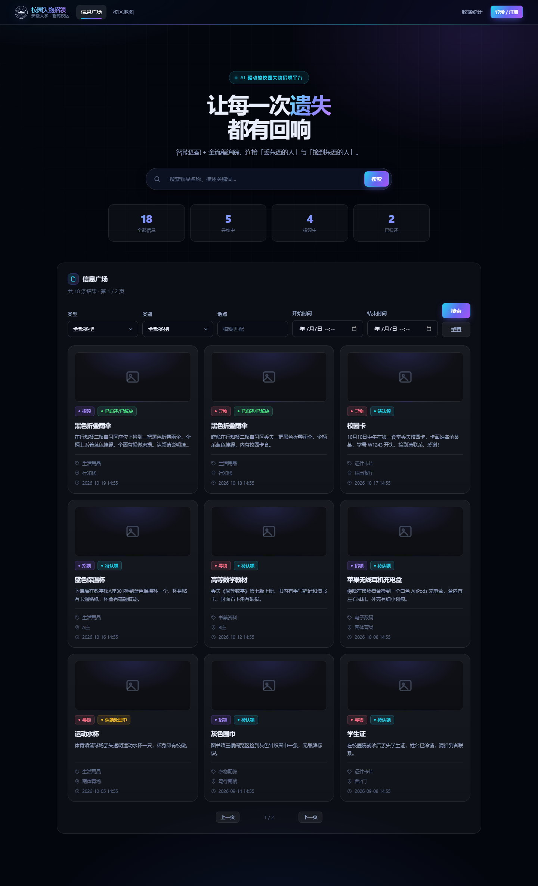
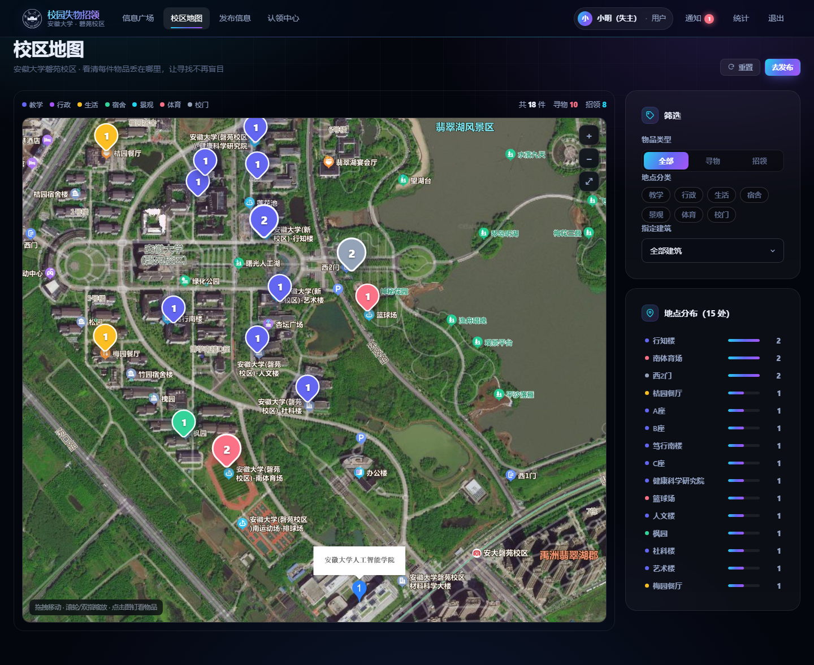
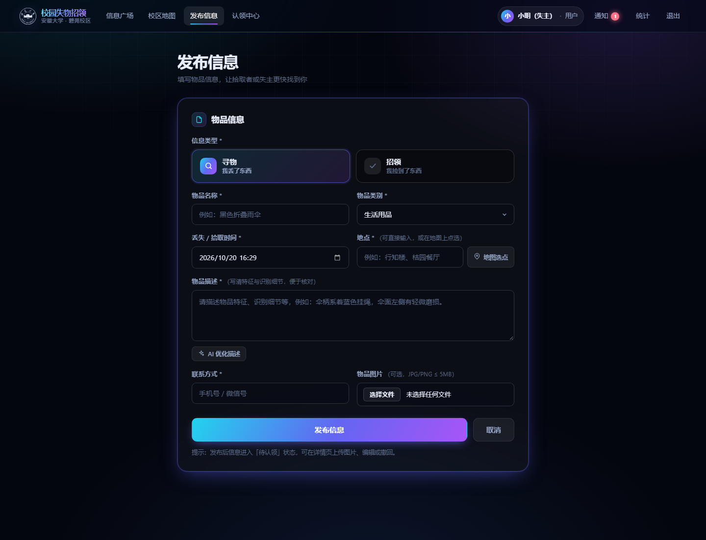
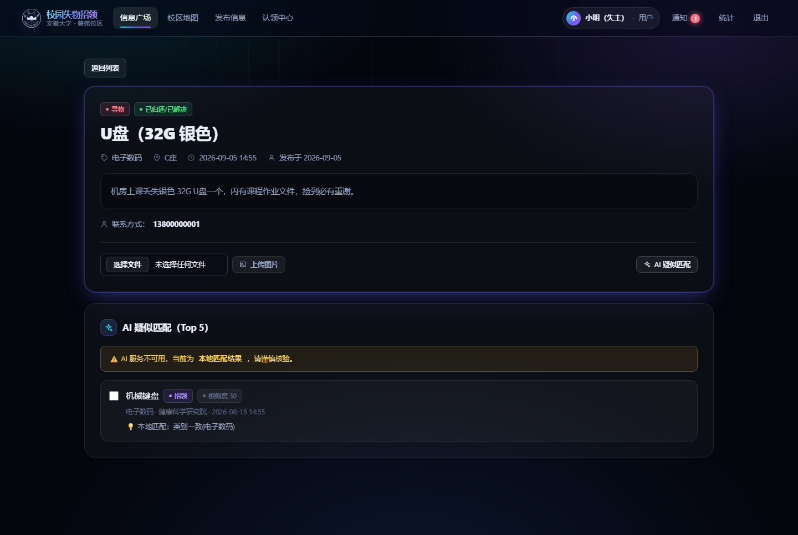
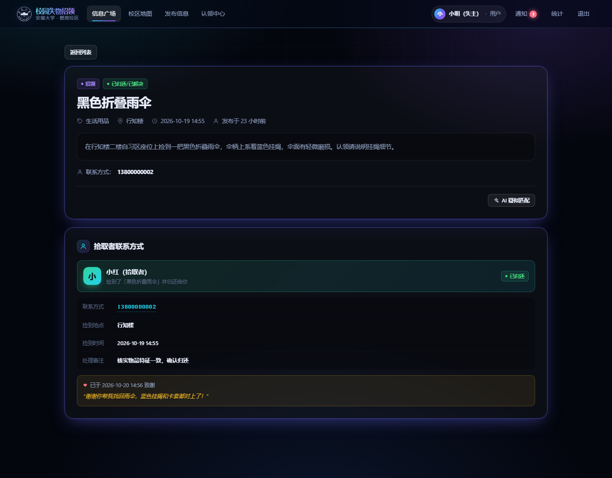
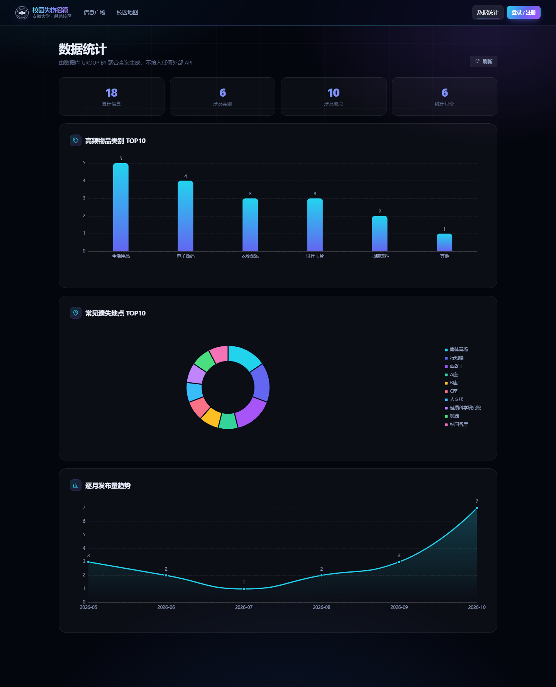
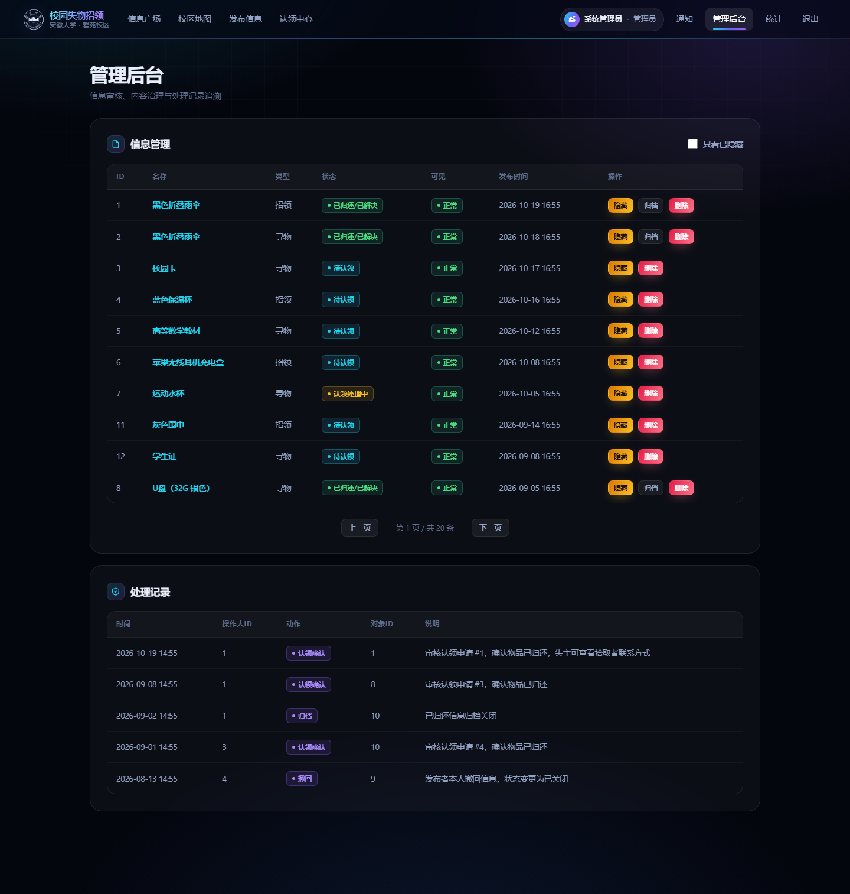
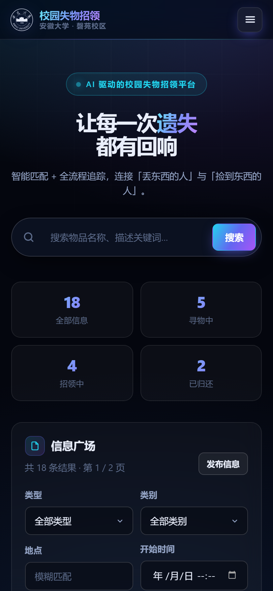

# 校园失物招领系统（Campus Lost & Found）

> Java 课程项目 · 企业场景软件开发实践
> 学号 **W124301024** ｜ 姓名 **范兆瑞**

一个面向校园场景的失物招领平台：失主发布「寻物」、拾取者发布「招领」，
系统通过 **AI 疑似匹配** 辅助双方对接，并以 **认领申请 → 审核 → 归还 → 归档**
的全流程追踪完成闭环。同时提供管理后台与数据统计，以及一个 Android WebView 壳 APK
用于移动端演示。

---

## 一、功能范围

### 必做功能 F1 ~ F8

| 编号 | 功能 | 说明 |
|:--|:--|:--|
| F1 | 用户注册 / 登录 / 登出 | BCrypt 密码哈希，Session 会话 |
| F2 | 发布失物 / 招领信息 | 必填校验、超长截断、非法类型拦截 |
| F3 | 组合检索与分页 | 类型 + 类别 + 地点 + 关键词 + 时间范围 |
| F4 | 认领申请与处理 | 申请 → 确认 / 拒绝 / 要求补充，状态联动 |
| F5 | 物品状态机 | 待认领 → 认领处理中 → 已归还 / 已关闭 |
| F6 | 管理后台 | 隐藏 / 恢复 / 删除 / 归档 + 处理记录留痕 |
| F7 | 数据持久化 | 重启后数据不丢失 |
| F8 | 统一异常处理 | 统一 `{code, message}` 结构与中文提示 |

### 扩展功能 E1 ~ E4

| 编号 | 功能 | 说明 |
|:--|:--|:--|
| E1 | 物品图片上传 | JPG / PNG，≤ 5MB，UUID 重命名 |
| E2 | AI 智能匹配与描述优化 | DeepSeek Chat API；未配置密钥时降级为本地算法 |
| E3 | 站内定向通知 | 仅当事双方可见，不做全站广播 |
| E4 | 数据统计 | 类别 TOP10 / 地点 TOP10 / 逐月趋势（GROUP BY 聚合） |

### 特色功能 F9 ~ F11（安徽大学磬苑校区定制）

| 编号 | 功能 | 说明 |
|:--|:--|:--|
| F9 | 感谢接力：查看拾取者联系方式 | 认领确认后，失主可看到是谁捡到的、联系方式与捡到地点，并发送致谢 |
| F10 | 校区地图热点 | 磬苑校区卫星底图 + 30 个真实建筑坐标，按地点聚合展示物品分布，支持按分类/类型筛选与缩放 |
| F11 | 发布时地图选点 | 发布页可在地图上点选位置，自动吸附至最近建筑并回填地点名，坐标随物品一并入库 |

---

## 二、技术栈

| 层次 | 技术 |
|:--|:--|
| 语言 | Java 17 |
| 框架 | Spring Boot 3.3.5、MyBatis-Plus 3.5.7 |
| 构建 | Maven 3.9.9 |
| 数据库 | 嵌入式 H2 2.2（MySQL 兼容模式，文件持久化至 `./data/lostfound`）<br>可选 MySQL 8（`application-mysql.yml` + `db/schema.sql`） |
| 前端 | HTML5 + 原生 JavaScript + ECharts 5（本地引入，完全离线可用） |
| AI | DeepSeek Chat API（OkHttp，10s 超时，失败重试 1 次，不可用时自动降级） |
| 移动端 | Android WebView 壳 APK（minSdk 24 / targetSdk 34） |

---

## 三、快速开始

### 1. 直接运行（推荐）

```bash
mvn clean package
java -jar target/lostfound.jar
```

Windows 下也可直接双击 `启动Windows.bat`。启动后访问 <http://localhost:8080>。

首次启动会自动建表并写入演示数据（20 条物品，覆盖 4 种状态与 6 个月历史）。

### 2. 开发模式（改前端不用重启）

```bash
mvn spring-boot:run \
  -Dspring-boot.run.arguments="--spring.web.resources.static-locations=file:./src/main/resources/static/ --spring.web.resources.cache.period=0"
```

### 3. 运行测试

```bash
mvn test
```

20 个自动化用例（单元测试 + MockMvc 接口测试）。另有端到端脚本 `e2e_test.sh`，
覆盖 40+ 个接口断言。

### 4. 可选：MySQL 8

```sql
CREATE DATABASE lostfound;
```

执行 `src/main/resources/db/schema.sql`，修改 `application-mysql.yml` 中的账号密码，然后：

```bash
java -jar target/lostfound.jar --spring.profiles.active=mysql
```

### 5. 可选：配置 DeepSeek AI

**不要把密钥写进代码或提交到仓库。** 两种方式任选：

- 新建 `src/main/resources/application-local.yml`，写入 `app.deepseek.api-key: sk-xxx`，
  然后 `--spring.profiles.active=local,default` 启动；
- 或设置环境变量 `DEEPSEEK_API_KEY=sk-xxx`。

未配置时，AI 功能自动降级为本地关键词提取与相似度算法，页面会明确提示
「AI 服务不可用，当前为本地匹配结果」，**属于允许的设计行为，不是缺陷**。

---

## 四、演示账号

| 账号 | 密码 | 角色 | 用途 |
|:--|:--|:--|:--|
| `admin` | `admin123` | 管理员 | 管理后台、内容治理、处理记录 |
| `alice` | `123456` | 普通用户 | 失主视角 |
| `bob` | `123456` | 普通用户 | 拾取者视角 |
| `carol` | `123456` | 普通用户 | 第三方隔离验证 |

> 以上均为课程演示用途，非真实密码。

---

## 五、演示路径（约 4 分钟）

1. **未登录**打开首页 → 看到公开列表，无「发布信息」入口。
2. 打开「校区地图」→ 卫星底图上按地点聚合显示物品分布，点击图钉查看该处物品，
   按「寻物 / 招领」或建筑分类筛选（F10）。
3. `alice` 登录 → 发布一条「招领」，点「AI 优化描述」生成草稿，
   再用「地图选点」在地图上点中建筑，地点自动回填（F11）。
4. 退出，`bob` 登录 → 用组合筛选（类别 + 地点 + 关键词）找到该信息。
5. 进入详情 → 点「AI 疑似匹配」查看 Top5 与相似理由 → 勾选完成人工核验 → 提交认领申请。
6. `alice` 登录 → 通知页看到提醒 → 认领中心确认 → 物品状态变为「已归还」。
7. **感谢接力**：`alice` 打开「黑色折叠雨伞」招领详情 →
   可见拾取者「小红（拾取者）」的联系方式、捡到地点与时间 → 点「发送致谢」（F9）。
8. `admin` 登录 → 管理后台隐藏一条信息、查看处理记录。
9. 打开「统计」页 → 三张图表由数据库 GROUP BY 聚合生成。
10. 重启服务 → 数据全部保留（F7）。

---

## 六、项目结构

```
lostfound/
├── pom.xml
├── 启动Windows.bat
├── e2e_test.sh                       # 端到端接口验证脚本
├── docs/screenshots/                 # 界面截图
├── tools/shot.js                     # 用 CDP 批量截图的工具
└── src/
    ├── main/
    │   ├── java/com/example/lostfound/
    │   │   ├── common/               # Result、BizException、全局异常处理
    │   │   ├── config/               # MyBatis-Plus、Web、演示数据初始化
    │   │   ├── controller/           # 8 个 REST 控制器
    │   │   ├── dto/                  # 请求对象与校验注解
    │   │   ├── entity/               # 实体与状态枚举
    │   │   ├── interceptor/          # 登录 / 管理员拦截器
    │   │   ├── mapper/               # MyBatis-Plus Mapper 与统计 SQL
    │   │   └── service/              # 9 个业务服务
    │   └── resources/
    │       ├── application.yml
    │       ├── application-mysql.yml
    │       ├── db/schema.sql
    │       └── static/               # 前端：9 个页面 + css + js + img
    └── test/java/com/example/lostfound/
        ├── ItemStatusTest.java       # 状态机单元测试
        ├── LocalScoreTest.java       # 本地匹配算法测试
        └── ApiIntegrationTest.java   # MockMvc 接口集成测试
```

---

## 七、界面预览

| 信息广场 | 校区地图 |
|:--|:--|
|  |  |

| 发布信息 + 地图选点 | 信息详情 + AI 匹配 |
|:--|:--|
|  |  |

| 感谢接力：拾取者联系方式 | 数据统计 |
|:--|:--|
|  |  |

| 管理后台 | 移动端 |
|:--|:--|
|  |  |

---

## 八、在线演示（GitHub Pages）

仓库 `docs/` 目录是一份**可直接打开的功能完整演示站**：
<https://fanzhaorui744.github.io/javawork/>

后端无法托管在 Pages 上，因此该站点使用 `js/offline.js` 在浏览器端接管全部
`/api/**` 请求，用内存 + localStorage 模拟真实后端（登录态、权限、状态机、
统计聚合全部可用），演示数据与本地服务完全一致。

---

## 九、已知限制

1. AI 功能依赖外部 DeepSeek API，不可用时降级为本地算法；
2. Android APK 为 WebView 壳，内嵌离线数据用于演示，不连接真实后端；
3. 会话保存在服务端内存，重启需重新登录（业务数据持久化，不丢失）；
4. 校区地图底图为静态卫星影像 + 手工标定的建筑坐标，非实时 GIS 服务；
5. 性能按课程演示规模设计，未针对高并发优化。

---

## 十、交付物

| 序号 | 文件 | 说明 |
|:--|:--|:--|
| 01 | `01_软件需求说明书.pdf` / `.docx` | 需求规格说明（SRS） |
| 02 | `02_项目开发计划书.pdf` / `.docx` | 开发计划、里程碑与风险 |
| 03 | `03_测试与迭代报告.pdf` | 测试用例、缺陷清单、追踪表 |
| 04 | `产品说明书_W124301024_范兆瑞.pdf` | 安装部署与使用手册 |
| 05 | `演示材料.pdf` | 现场演示脚本 |
| 06 | 源码 + APK | 本仓库 / `apk/` 目录 |
